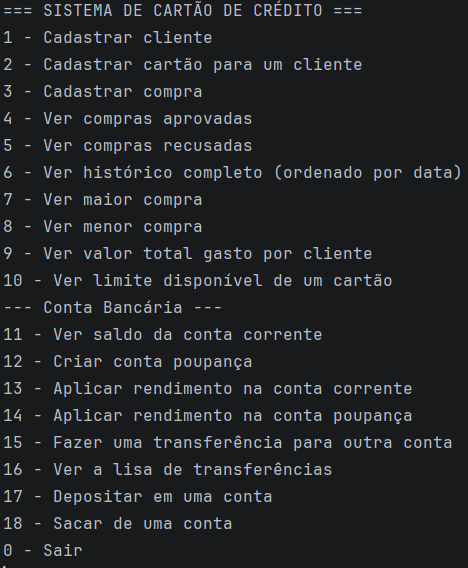

BankCore

Sistema bancário desenvolvido em Java puro, com foco em orientação a objetos, tratamento de exceções e consumo de APIs externas. Projeto de portfólio construído com o objetivo de aplicar, na prática, conceitos usados no desenvolvimento de sistemas do setor financeiro.

💡 Este projeto começou como um gerenciador de cartões de crédito e evoluiu para um sistema bancário mais completo — o histórico de commits reflete essa evolução real, módulo por módulo.

📌 Sobre o projeto

O BankCore simula as operações centrais de um banco: gestão de clientes, cartões de crédito, contas correntes e poupanças, transferências entre contas e rendimento sobre o saldo — incluindo integração real com a API do Banco Central do Brasil para calcular a taxa CDI.

Todo o sistema roda via terminal (CLI), com um menu interativo construído em Java puro, sem frameworks — o próximo passo natural do projeto é evoluir para uma API REST com Spring Boot.

⚙️ Funcionalidades
Módulo de cartão de crédito
Cadastro de clientes e cartões
Registro de compras (à vista ou parceladas), com limite de crédito por cartão
Aprovação/recusa automática de compras conforme limite disponível
Histórico de compras aprovadas e recusadas, ordenado por data
Consulta de maior/menor compra e valor total gasto por cliente
Consulta de limite disponível
Módulo bancário
Toda conta é criada automaticamente com uma conta corrente, vinculada ao cliente
Abertura opcional de conta poupança
Depósitos e saques, com validação de saldo insuficiente
Transferências entre contas (mesma instituição), reaproveitando a lógica de depósito/saque
Extrato completo por conta, com descrição diferenciada para transferências
Rendimento aplicado de verdade (não apenas simulado):
Conta poupança: taxa fixa de 0,5% ao mês
Conta corrente: taxa CDI do dia, obtida em tempo real via API pública do Banco Central
🧠 Conceitos aplicados
Programação orientada a objetos: herança, classes abstratas, polimorfismo (Account como classe-mãe de CheckingAccount e SavingsAccount)
Coleções: ArrayList para histórico de compras, cartões e transações
Tratamento de exceções customizadas: InsufficientBalanceException, SavingsAccountAlreadyExistsException, CdiApiException
Consumo de API REST externa: HttpClient + desserialização de JSON com Gson
Java Records para modelar a resposta da API do Banco Central
Javadoc em todas as classes e métodos principais
🔌 API externa utilizada

O rendimento da conta corrente é calculado com base na taxa CDI real, obtida via API de séries temporais do Banco Central do Brasil:

https://api.bcb.gov.br/dados/serie/bcdata.sgs.12/dados/ultimos/1?formato=json
🗂️ Estrutura do projeto
com.felipe.bankcore
├── model
│   ├── Customer, Card, Purchase
│   ├── Account (abstract), CheckingAccount, SavingsAccount
│   ├── Transaction, TransactionType, RegistroCdi
│   └── PurchaseStatus, PurchaseValueComparator
├── service
│   └── Bank
├── exception
│   ├── InsufficientBalanceException
│   ├── SavingsAccountAlreadyExistsException
│   └── CdiApiException
└── Main
▶️ Como executar

Pré-requisitos: JDK 17+ e a biblioteca Gson no classpath.

Clone o repositório
Abra o projeto na IntelliJ IDEA (ou outra IDE de sua preferência)
Certifique-se de que o Gson está adicionado como dependência
Execute a classe Main
Navegue pelo menu interativo via terminal
🛣️ Próximos passos

Este projeto é a primeira etapa de um roadmap maior:

✅ BankCore CLI — este repositório, Java puro, sem persistência
🔜 BankCore API — evolução deste mesmo projeto para uma API REST com Spring Boot, Spring Data JPA e banco de dados (H2/PostgreSQL)
🔜 FinanceTrack API — projeto independente de controle financeiro, consumindo API pública de câmbio
👤 Autor

Desenvolvido por Felipe, como parte de estudos em Java com foco em ingressar na área de banking/fintech.