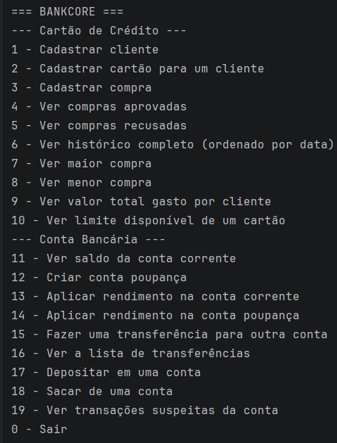

# 🏦 BankCore

Sistema bancário desenvolvido em **Java puro**, com foco em orientação a objetos, tratamento de exceções e consumo de APIs externas. Projeto de portfólio construído para aplicar, na prática, conceitos usados no desenvolvimento de sistemas do setor financeiro.

> 💡 Este projeto começou como um gerenciador de cartões de crédito e evoluiu para um sistema bancário mais completo — o histórico de commits reflete essa evolução real, módulo por módulo.

## 🎬 Demonstração



## 📌 Sobre o projeto

O BankCore simula o **sistema interno (back-office) de um banco**: a camada que processa operações como gestão de clientes, cartões de crédito, contas correntes e poupanças, transferências entre contas e rendimento sobre o saldo — incluindo integração real com a API do Banco Central do Brasil para obter a taxa CDI.

Todo o sistema roda via terminal (CLI), com um menu interativo construído em Java puro, sem frameworks. O próximo passo do projeto é evoluí-lo para uma **API REST com Spring Boot**, mantendo a lógica de negócio já construída (veja a seção **Próximos passos**).

## ⚙️ Funcionalidades

### Módulo de cartão de crédito
- Cadastro de clientes e cartões
- Registro de compras (à vista ou parceladas), com limite de crédito por cartão
- Aprovação/recusa automática de compras conforme o limite disponível
- Histórico de compras aprovadas e recusadas, ordenado por data
- Consulta de maior/menor compra e valor total gasto por cliente
- Consulta de limite disponível

### Módulo bancário
- Toda conta é criada automaticamente com uma conta corrente, vinculada ao cliente
- Abertura opcional de conta poupança
- Depósitos e saques, com validação de saldo insuficiente e de valores inválidos (zero ou negativos)
- Transferências entre contas (mesma instituição), reaproveitando a lógica de depósito/saque
- Extrato completo por conta, com descrição diferenciada para transferências
- Rendimento aplicado de verdade (não apenas simulado):
  - **Conta poupança:** taxa fixa de 0,5% ao mês
  - **Conta corrente:** taxa CDI do dia, obtida em tempo real via API pública do Banco Central

### Detecção de transações suspeitas
- Depósitos, saques e transferências com valor **igual ou maior que R$ 5.000,00** são sinalizados como suspeitos
- Antes de concluir a operação, o sistema pede confirmação; se o usuário recusar ou digitar uma opção inválida, a operação é cancelada:

```
Qual o valor que deseja sacar ?
6000
Este valor está acima do normal, deseja continuar mesmo assim ?
Se SIM pressione 1, se NÃO pressione 2.
```

- Uma opção do menu lista as transações suspeitas de uma conta, filtradas com Stream API
- A regra fica centralizada na classe `FraudDetector` (Detector de Fraude), com o limite definido como constante
- As compras no cartão de crédito seguem a regra própria de aprovação por limite e não passam por essa confirmação

## 🧠 Conceitos aplicados

- **Programação orientada a objetos:** herança, classes abstratas e polimorfismo (`Account` como classe-mãe de `CheckingAccount` e `SavingsAccount`)
- **Stream API:** `filter` e `toList` para filtrar transações suspeitas
- **Sobrecarga de métodos (*overloading*):** `isSuspicious(Transaction)` e `isSuspicious(double)`, com a regra de negócio em um único lugar
- **Coleções:** `ArrayList` para histórico de compras, cartões e transações
- **Tratamento de exceções customizadas:** `InsufficientBalanceException`, `InvalidAmountException`, `SavingsAccountAlreadyExistsException`, `CdiApiException`
- **Cláusulas de guarda (*guard clauses*):** valores inválidos são rejeitados no início de `deposit` e `withdraw`, protegendo qualquer chamador
- **Consumo de API REST externa:** `HttpClient` + desserialização de JSON com Gson
- **Java Records** para modelar a resposta da API do Banco Central
- **Refatoração:** método auxiliar `confirmHighValue`, reaproveitado em depósito, saque e transferência
- **Constantes** (`static final`) para regras de negócio configuráveis
- **Javadoc** em todas as classes e métodos principais

## 🔌 API externa utilizada

O rendimento da conta corrente é calculado com base na taxa CDI real, obtida via API de séries temporais do Banco Central do Brasil:

```
https://api.bcb.gov.br/dados/serie/bcdata.sgs.12/dados/ultimos/1?formato=json
```

## 🗂️ Estrutura do projeto

```
com.felipe.bankcore
├── model
│   ├── Customer, Card, Purchase
│   ├── Account (abstract), CheckingAccount, SavingsAccount
│   ├── Transaction, TransactionType, RegistroCdi
│   └── PurchaseStatus, PurchaseValueComparator
├── service
│   ├── Bank
│   └── FraudDetector
├── exception
│   ├── InsufficientBalanceException
│   ├── InvalidAmountException
│   ├── SavingsAccountAlreadyExistsException
│   └── CdiApiException
└── Main
```

## ▶️ Como executar

**Pré-requisitos:** JDK 17+ e a biblioteca Gson no classpath.

1. Clone o repositório
2. Abra o projeto na IntelliJ IDEA (ou outra IDE de sua preferência)
3. Certifique-se de que o Gson está adicionado como dependência
4. Execute a classe `Main`
5. Navegue pelo menu interativo via terminal

## 🔄 Fluxo de trabalho

- Commits pequenos e granulares, seguindo o padrão **Conventional Commits** (`feat:`, `fix:`, `refactor:`, `docs:`)
- Uma branch por funcionalidade, integrada à `main` via **Pull Request**

## 🛣️ Próximos passos

Este projeto é a primeira etapa de um roadmap maior:

- ✅ **BankCore CLI** — Java puro, com detecção de transações suspeitas, confirmação de valores altos e validação de valores inválidos
- 🔜 **BankCore API** — evolução deste mesmo projeto, reaproveitando as classes de `model` e `service`. Etapas previstas (ordem a definir):
  - **API REST com Spring Boot** — endpoints previstos:
    - `POST /customers` — cadastrar cliente
    - `POST /accounts/{id}/deposit` — depositar
    - `POST /accounts/{id}/withdraw` — sacar
    - `POST /accounts/{id}/transfer` — transferir
    - `GET /accounts/{id}/statement` — consultar extrato
    - `POST /customers/{id}/savings-account` — abrir conta poupança
  - **Persistência com Spring Data JPA e MySQL** — substituindo as listas em memória
- 🔜 **FinanceTrack API** — projeto independente de controle financeiro, consumindo API pública de câmbio

## 👤 Autor

Desenvolvido por **Felipe**, como parte de estudos em Java com foco em ingressar na área de banking/fintech.

- GitHub: [felipefbss](https://github.com/felipefbss)
- LinkedIn: [felipefbss](https://www.linkedin.com/in/felipefbss/)